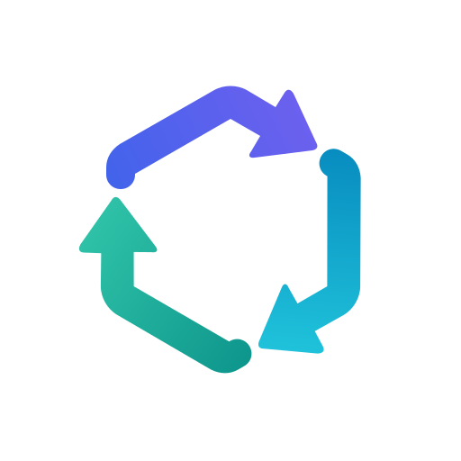

# api-translator

<div align="center">



**Three API protocols. One Go library.**

**English** · [简体中文](README.zh-CN.md)

[Install](#installation) · [Quick start](#quick-start) · [Streaming](#streaming-responses) · [Protocol docs](docs/protocol-conversion.md) · [Releases](https://github.com/dillonzq/api-translator/releases)

[](LICENSE)
[](https://github.com/dillonzq/api-translator/releases/tag/v0.1.0)
[](go.mod)
[](go.mod)

</div>

---

A standalone Go library for request, non-streaming response, and SSE conversion between OpenAI Chat Completions, OpenAI Responses, and Anthropic Messages. Uses only the Go standard library and requires Go **1.26.7+**.

Go module: `github.com/dillonzq/api-translator`; package: `translator`.

## Supported protocols

All six cross-protocol directions are supported, along with same-protocol request model rewriting and response passthrough. Conversion covers text, function tools, reasoning, usage, structured output, and representable URL citations. See [protocol conversion](docs/protocol-conversion.md) for tool identity restoration, hosted search, and streaming limits.

| Constant | Format value | Protocol |
| --- | --- | --- |
| `FormatChatCompletions` | `chat-completions` | Chat Completions |
| `FormatResponses` | `responses` | Responses |
| `FormatMessages` | `messages` | Messages |

Callers map external format identifiers to these constants. Only the three values above are accepted; Gemini and a separate Codex format are unsupported.

## Installation

```sh
go get github.com/dillonzq/api-translator@v0.1.0
```

For a private checkout, configure Git authentication for an account with repository access and install with:

```sh
GOPRIVATE=github.com/dillonzq/api-translator \
go get github.com/dillonzq/api-translator@v0.1.0
```

## Quick start

This example converts a Responses request to Messages:

```go
package main

import (
    "fmt"
    "log"

    translator "github.com/dillonzq/api-translator"
)

func main() {
    state := translator.NewRequestState()
    payload := []byte(`{"model":"client-model","input":"Hello"}`)
    body, err := translator.ConvertRequest(
        translator.FormatMessages, "upstream-model",
        translator.FormatResponses, payload, state,
    )
    if err != nil {
        log.Fatal(err)
    }
    fmt.Println(string(body))
}
```

Send the converted request through your HTTP client. When the upstream response arrives, use the same `state`:

```go
outputBody, err := translator.ConvertResponse(
    upstreamFormat, outputFormat, upstreamStatus, responseBody, state,
)
```

`sourceFormat` describes the input request, `upstreamFormat` describes the upstream response, and `outputFormat` describes the response the client needs. The output protocol may differ from the input request protocol. Callers choose and supply the upstream model name.

Use a separate `RequestState` for each request. Its zero value is usable. Responses requests converted to another protocol require state to restore tool names, namespaces, and custom identities. Other cases without mappings or diagnostics may use `nil`. Do not reuse or mutate state concurrently across requests; call each converter sequentially.

## Streaming responses

```go
stream, err := translator.NewStreamConverter(upstreamFormat, outputFormat, state)
// Check err before using stream.
events, done, err := stream.Feed(networkChunk)
// Send events in order, handling done and err.
tail, err := stream.Finish()
// Call Finish on upstream EOF, send tail, and handle err.
```

`Feed` accepts arbitrary network byte chunks and returns complete events ready to write to an SSE connection. Multiple `data:` lines and LF, CRLF, and CR separators are supported. Chat output includes one `data: [DONE]`; synthesized Responses events contain increasing `sequence_number` values.

`Finish` checks that a valid terminal signal arrived before EOF. Once conversion fails, subsequent `Feed` / `Finish` calls continue returning an error without emitting successful completion. A call may return both completed events and an error; preserve their order and stop further normal conversion.

Callers own HTTP, authentication, network reads, cancellation, retries, and model capability checks.

## Loss diagnostics and errors

Select a request policy and read diagnostics after conversion:

```go
state := translator.NewRequestState()
state.Options.LossPolicy = translator.LossPolicySafe
// Convert requests and responses using state, then read:
diagnostics := state.Diagnostics()
```

| Policy | Request behavior |
| --- | --- |
| `LossPolicyAllow` (default) | Allow known losses and record diagnostics |
| `LossPolicySafe` | Reject known losses that change request semantics |
| `LossPolicyStrict` | Reject all reported request losses |

Responses and streams report known losses without rejecting solely because of this policy. Protocol errors and unrepresentable actual output still fail. Diagnostics contain `Code`, `Path`, `Message`, `Semantic`, `From`, and `To`; the accessor returns a copy. A `nil` state disables collection. Rules inspect explicit protocol field paths, never business data inside tool inputs, results, or JSON Schema; strict mode is not a guarantee that every protocol field is lossless.

Conversion errors are `*translator.Error`, carrying `Class`, `Message`, `StatusCode`, and `Retryable`. Error constructors redact secrets; `StatusCode == 0` means no explicit HTTP status was supplied. Callers determine their error response and retry policy. Use `translator.Redact` when wrapping your own messages.

Use `FromNetwork` and `PostFirstByteNetwork` to classify transport errors before and after the first upstream byte, respectively.

## Conversion boundaries

Same-protocol requests rewrite only `model` and preserve other fields; an unchanged model returns the original bytes. Cross-protocol conversion uses direct paths, with preservation determined by the destination protocol.

The default entry points do not parse model-name suffixes. For conventions such as `model(high)` or `model(8192)`, explicitly use the `thinking` subpackage; see [reasoning controls and suffixes](docs/protocol-conversion.md#reasoning-controls-and-suffixes). Levels are not filtered against model capabilities, and budgets are not automatically clamped.

Structured output, tools, citations, search, termination rules, and remaining limitations are described in [protocol conversion](docs/protocol-conversion.md).

## Development and validation

```sh
go test -race ./...
go vet ./...
gofmt -l .
```

Regular tests validate 27 conversion snapshots. Update them only after reviewing the protocol output changes:

```sh
go test . -run TestProtocolGolden -update
```

Stream fuzz tests check chunking invariance and irreversible failure states:

```sh
go test . -run '^$' -fuzz '^FuzzStreamChunkBoundaries$' -fuzztime=10s
go test . -run '^$' -fuzz '^FuzzSSEFailureIsTerminal$' -fuzztime=10s
```

Licensed under [MIT](LICENSE).
