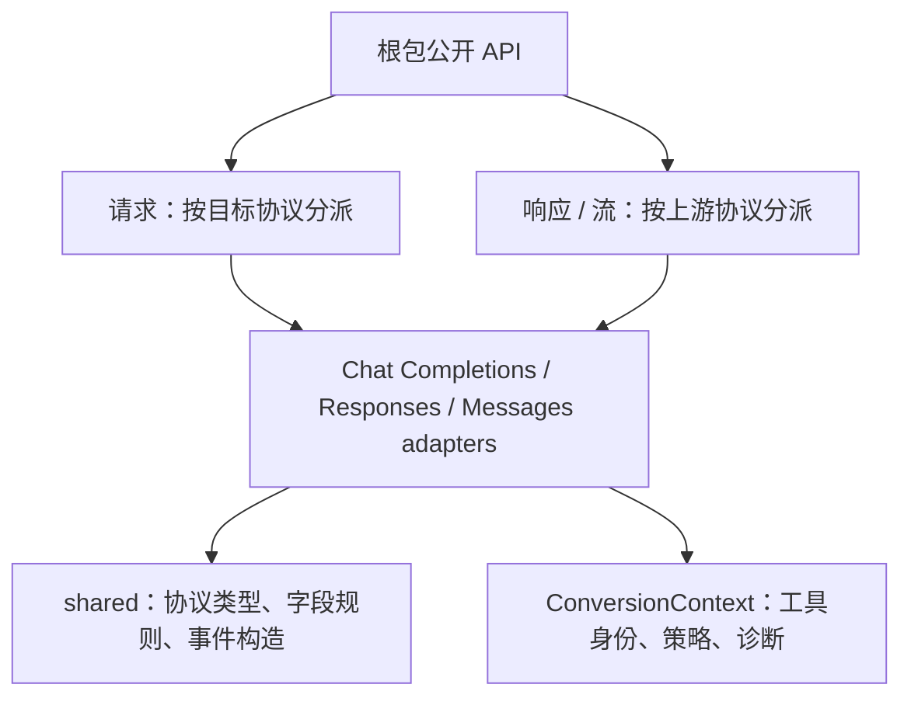

# 代码结构与维护约定

[English](architecture.md) | 简体中文 · [协议转换说明](protocol-conversion.zh-CN.md)

## 入口与转换方向

根包提供公开 API、格式校验、请求损耗策略和 SSE 传输边界。HTTP、模型能力和重试由调用方负责。

请求转换按**目标协议**选择 adapter；普通响应和流式响应按**上游协议**选择 adapter。响应转换器中的 `outputFormat` 始终表示客户端需要的协议。保留六条直接转换路径，同协议请求统一使用 `RewriteModelID`，只改写模型。

## 文件职责

| 位置 | 职责 |
| --- | --- |
| 根包 `request.go`、`response.go`、`stream.go` | 公开入口、分派、错误状态锁定、SSE 包装和 Responses 序号 |
| adapter `request.go`、`convert.go` | 请求与普通响应的直接映射 |
| adapter `stream.go` | 上游解析、事件分派和结束校验 |
| adapter `messages_stream.go`、`chat_stream.go`、`responses_stream.go` | 各目标的流式输出；具体文件按该 adapter 支持的路径设置 |
| Responses `native_output.go`、`stream_content.go` | 原生工具恢复，以及文本、推理和引用快照补齐 |
| shared `types_*.go`、`content.go`、`media.go` | 协议解码类型与内容表示 |
| shared `events_*.go`、`output_assembler.go`、`results.go` | 目标事件和普通响应构造 |
| shared `sse_framer.go`、`sse_encode.go` | SSE 分帧和编码 |
| shared `usage.go`、`terminal.go` | usage 和结束原因映射 |
| shared `tool_identity.go`、`responses_tools.go`、`normalize_responses.go` | 工具身份规则、跨协议规范化和保留原生字段的显式规范化 |
| shared `context.go`、`diagnostic_collector.go`、`diagnostics.go` | 请求上下文、诊断收集与损耗规则 |
| `thinking` | 显式推理控制和模型后缀 |

## 工具与状态

`RequestState` 的公开接口不变，内部持有 `ConversionContext`。上下文分别持有 `ToolRegistry`、转换选项和诊断收集器。诊断按首次记录顺序去重，返回独立副本。

原生 Responses 规范化使用 `json.RawMessage` 保留未知字段和精确数值；跨协议路径使用已建模类型。两条路径共享工具名称展开、声明去重、身份碰撞和历史 / tool choice 引用校验规则，不通过对整份请求的统一重编码实现复用。

声明去重只作用于本次输入中的重复声明，首次声明优先；状态中已有身份仍参与冲突校验。历史及选择引用使用原始名称和 namespace，不能将展平后的名称当作另一种工具身份。

两个公开规范化路径使用 `WithToolTransaction`：成功提交工具注册表，失败保留原身份；两种结果都保留诊断。策略只影响请求阶段。

## 流式状态

转换器分别组织目标状态：Chat Completions adapter 的 `messagesOutput` 和 `responsesOutput`；Messages adapter 的 `chatOutput` 和 `responsesOutput`；Responses adapter 的 `messagesOutput` 和 `nativeOutput`。源工具身份、参数补齐和协议结束判断仍由上游 adapter 负责。

Chat → Messages 和 Responses → Messages 共用 `MessagesBlocks`，统一递增索引、先关闭再开始和关闭后不发增量。队列保留各自的完成规则：Chat 工具通常等待整条流的完成信号，Responses 工具可以逐项完成。引用窗口和搜索结果的排队规则保留在对应 adapter 中。

`Feed` / `Finish` 允许同时返回已生成的事件和错误。错误不能丢弃本次调用中已完成的事件；公开转换器锁定首个错误，后续调用不再生成正常事件或成功结束。

## 验证约定

新增协议行为优先通过公开入口测试；内部测试覆盖解析及状态组件。27 份快照固定现有输出，结构重构不应更新快照。

错误流测试覆盖完整输入、逐字节输入、无最终分隔符及 EOF 缺失终止状态，也检查单个 Chat chunk 或 Responses 终止快照内部先生成内容、后失败时的内容与顺序。工具测试跨原生和两个跨协议入口检查首次声明、历史碰撞、状态回滚与诊断保留。

验证命令见 [README](../README.zh-CN.md#开发与验证)。
